<p align="center">
  
</p>

<p align="center">
  <a href="https://github.com/ishandutta2007/Awesome-Awesome-Awesome"></a><a href="https://discord.gg/jc4xtF58Ve"></a> <a href="https://github.com/ishandutta2007/Awesome-Grant-Management-Software/stargazers"></a> <a href="https://github.com/ishandutta2007/Awesome-Grant-Management-Software/network/members"></a> <a href="https://github.com/ishandutta2007/Awesome-Grant-Management-Software/pulls"></a> <a href="https://github.com/ishandutta2007/Awesome-Grant-Management-Software/blob/main/LICENSE"></a> <a href="https://github.com/ishandutta2007"></a>
</p>

<h1 align="center">🌟 Awesome Grant Management Software 🌟</h1>

<p align="center">
  <strong>The definitive curated index of SaaS products, cloud platforms, and open-source software for Grant Lifecycle Management, Review Workflows, and Funding Distribution.</strong>
</p>

<p align="center">
  <em>Designed for foundation executives, grantmakers, philanthropic directors, research administrators, government agencies, and software engineers building grant platforms.</em>
</p>

---

## 📑 Table of Contents

- [🎯 Overview](#-overview)
- [📊 Sector Overview & Market Dynamics](#-sector-overview--market-dynamics)
- [🏢 SaaS & Hosted Grant Management Platforms](#-saas--hosted-grant-management-platforms)
- [🔓 Open-Source GitHub Projects](#-open-source-github-projects)
- [🏗️ Recommended Architecture for Custom Self-Hosting](#️-recommended-architecture-for-custom-self-hosting)
- [🤝 How to Contribute](#-how-to-contribute)
- [⚖️ Disclaimer & Regulatory Compliance](#️-disclaimer--regulatory-compliance)
- [⭐ Star History](#-star-history)
- [💖 Support & Sponsoring](#-support--sponsoring)
- [📜 License](#-license)

---

## 🎯 Overview

**Grant Management Software (GMS)** streamlines the complex, high-stakes funding lifecycle for grantmakers, public institutions, and grantseeking organizations. From publishing funding announcements and accepting online applications to coordinating blind multi-tiered reviews, disbursing capital tranches, tracking grantee outcomes, and complying with stringent audit requirements (such as OMB Uniform Guidance 2 CFR 200), choosing the right software platform ensures operational transparency and financial integrity.

This directory tracks the top commercial enterprise solutions alongside active open-source platforms to empower teams seeking scalable cloud automation or sovereign self-hosted infrastructure.

---

## 📊 Sector Overview & Market Dynamics

The global **Grant Management Software (GMS)** market is estimated at **$2.6B to $3.2B** in 2025–2026 and is forecasted to expand to **$4.5B–$5.0B by 2030**, progressing at a Compound Annual Growth Rate (CAGR) of approximately **10.5%**.

The sector is **moderately to highly fragmented** rather than a "winner-take-all" concentrated market. Unlike horizontal CRM suites, grantmaking encompasses distinct regulatory and operational silos:
- **Public Sector & Federal Agencies:** Require stringent adherence to OMB Uniform Guidance (2 CFR 200), sub-recipient monitoring, and auditable accounting.
- **Philanthropic & Family Foundations:** Require IRS 990 / expenditure responsibility tracking, mission alignment, and board review workflows.
- **Higher Education & Research Institutions:** Require pre-award proposal management, faculty effort certification, and post-award compliance.
- **Corporate Social Responsibility (CSR):** Focus on employee giving matching, ESG impact measurement, and partner sponsorships.

Because no single vendor satisfies every vertical and regulatory regime, the ecosystem thrives on a diverse combination of established enterprise SaaS leaders, nimble mid-market specialists, and flexible open-source architectures.

---

## 🏢 SaaS & Hosted Grant Management Platforms

The table below lists top commercial SaaS grant management systems sorted in **descending order by company size** (market capitalization, valuation, or estimated annual revenue).

| Platform | Company Size (Valuation / Revenue) | Starting Pricing | Free Tier / Trial Limit | Key Capabilities & Target Sector | Official Website |
| :--- | :--- | :--- | :--- | :--- | :--- |
| **Salesforce Grantmaking** | **$290B Market Cap** / $38B Annual Revenue *(Salesforce Inc., NYSE: CRM)* | **$285 / user / month** *(Nonprofit Cloud Sales/Service Max edition, billed annually; base Core starts at $70/mo)* | **10 free core licenses** for qualified 501(c)(3) nonprofits via Salesforce *Power of Us* program; or 30-day sandbox trial | End-to-end grantmaking CRM, online applicant portal (Experience Cloud), budget milestone tracking, disbursement schedules, and impact analytics | [Visit Salesforce](https://www.salesforce.com/) |
| **Blackbaud Grantmaking** | **$3.6B Market Cap** / $1.15B Annual Revenue *(Blackbaud Inc., NASDAQ: BLKB)* | **~$325 / user / month** *(~$3,900/year entry baseline subscription + implementation)* | **No permanent free plan**; 1-on-1 personalized guided product demo & customized sandbox evaluation environment upon sales request | Complete grant lifecycle solution for private and community foundations, reviewer portals, multi-entity branch management, and automated payment disbursements | [Visit Blackbaud](https://www.blackbaud.com/) |
| **SurveyMonkey Apply** | **$1.5B Valuation** / $510M Annual Revenue *(Momentive Global / Symphony Technology Group)* | **$7,000 / year** *(Pro plan; covers 1 program and up to 1,000 applicants, billed annually)* | **No free plan for Apply**; 14-day free trial on standard survey engine, or customized demo sandbox environment for Apply | Fluid online intake forms, blind reviewer scoring rubrics, applicant notifications, and workflow automations for scholarships, grants, and awards | [Visit SurveyMonkey Apply](https://www.surveymonkey.com/) |
| **Submittable** | **~$500M Valuation** / $66.6M Annual Revenue *(Backed by Accel-KKR, IVP; acquired WizeHive)* | **$3,000 / year** *(Standard entry-level grantmaking plan; or $39/month for CLMP literary publisher members)* | **No permanent free tier**; personalized sales walkthrough and custom sandbox environment provided during onboarding | High-volume submission intake, corporate giving & CSR distribution, collaborative committee reviews, and automated applicant communications | [Visit Submittable](https://www.submittable.com/) |
| **AmpliFund** | **$450M Valuation** *(Parent Euna Solutions: $110M ARR; AmpliFund unit: $18.4M ARR)* | **$5,000 / year** *($416/month billed annually for Core Grant Seeker or Grant Maker tier)* | **No free plan**; custom 30-day proof-of-concept pilot demo environment for government agencies and eligible nonprofits | Built specifically for state, local, and tribal governments and public sector agencies with deep OMB Uniform Guidance (2 CFR 200) compliance | [Visit AmpliFund](https://www.amplifund.com/) |
| **Foundant Technologies (GLM)** | **$170M+ Funding** / ~$30M Annual Revenue *(Backed by Sverica Capital & L Squared)* | **$6,500 / year** *(Basic plan; Standard tier at $9,900/year + $2,500 initial implementation)* | **No permanent free tier**; live personalized guided demo and evaluation sandbox instance upon sales qualification | Grant Lifecycle Manager (GLM) for philanthropic foundations, featuring Fia™ AI data intelligence advisor, scholarship tracking, and finance CRM integrations | [Visit Foundant](https://www.foundant.com/) |
| **SmartSimple Cloud** | **Privately Held** / ~$24M Annual Revenue | **£40 / user / month** *(~$52/mo for low-usage internal staff, £130/mo for high-usage; £650/mo base community portal)* | **No public self-service tier**; 30-day proof-of-concept sandbox access available via UK G-Cloud and enterprise sales | Modular, enterprise-grade cloud automation for complex international foundations, research grant administration, and multi-currency funding | [Visit SmartSimple](https://www.smartsimple.com/) |
| **Fluxx (Grantmaker & Grantseeker)** | **$40M+ Funding** / ~$20M Annual Revenue *(Backed by Metamorph Partners & ABS Capital)* | **$13,000 / year** *(Fluxx Grantmaker; or $14.99/month for Fluxx Grantseeker Classic)* | **Grantseeker Basic is free forever** (unlimited users, basic grant/deadline tracking); 14-day free trial on Grantseeker Premium; sandbox demo for Grantmaker | Trusted by 10 of the 20 largest global foundations for multi-million-dollar funding lifecycles, real-time board dashboards, and grantee outcome tracking | [Visit Fluxx](https://www.fluxx.io/) |
| **WizeHive Zengine** | **Acquired by Submittable** / ~$12M Annual Revenue standalone *(Formerly Luminate Capital)* | **$3,995 / year** *(~$333/month entry annual contract)* | **No free plan**; custom guided interactive workflow demo and sandbox environment upon sales inquiry | Highly configurable and open-architected grant, fellowship, and award management platform with robust external reviewer portals and REST APIs | [Visit WizeHive](https://www.wizehive.com/) |
| **Good Grants** | **Privately Held** / ~$6M Annual Revenue *(Creative Force / Awards Force Pty Ltd)* | **€3,000 / year** *(~$3,250/year or ~$270/month; includes $10 free AI credits)* | **14-day free trial** *(no credit card required) with unlimited applications, full scoring rubric access, and $10 in AI testing credits* | Modern, multilingual, and multi-currency grant platform with visual form builders, customizable reviewer scoring rubrics, and strict data residency options | [Visit Good Grants](https://goodgrants.com/) |

---

## 🔓 Open-Source GitHub Projects

Open-source grant management tools and funding frameworks enable complete data sovereignty, custom audit workflows, self-hosted deployment, and zero vendor lock-in.

The repositories below are **sorted in descending order by GitHub star count**. Each project includes a real-time star badge linking directly to its GitHub stargazers page.

1. **[Odoo](https://github.com/odoo/odoo)** [](https://github.com/odoo/odoo/stargazers)  
   *Extensible open-source enterprise suite with nonprofit modules, project accounting, donor CRM, and grant milestone tracking.*  
   - **Stack**: Python, JavaScript, PostgreSQL  
   - **License**: LGPL-3.0  
   - **Highlights**: Modular architecture allows configuring custom grant intake pipelines, expense approvals, and financial disbursements connected directly to double-entry accounting.

2. **[Metabase](https://github.com/metabase/metabase)** [](https://github.com/metabase/metabase/stargazers)  
   *Open-source business intelligence and data visualization platform for grant reporting and funding transparency.*  
   - **Stack**: Clojure, TypeScript, React  
   - **License**: AGPL-3.0  
   - **Highlights**: Connects instantly to self-hosted grant databases to generate public transparency portals, funding heatmaps, demographic distribution charts, and post-award audit reports.

3. **[ERPNext](https://github.com/frappe/erpnext)** [](https://github.com/frappe/erpnext/stargazers)  
   *Comprehensive open-source ERP system featuring a dedicated Non-Profit module for grant management and fund accounting.*  
   - **Stack**: Python (Frappe Framework), MariaDB, JavaScript  
   - **License**: GPL-3.0  
   - **Highlights**: Features native tracking for Grant Applications, Grant Accounting, Volunteer Management, Donor Relationships, and multi-currency bank disbursements.

4. **[AI for Grant Writing](https://github.com/eseckel/ai-for-grant-writing)** [](https://github.com/eseckel/ai-for-grant-writing/stargazers)  
   *Curated open-source toolkit and prompt engineering framework for leveraging LLMs to draft, optimize, and review grant applications.*  
   - **Stack**: Python, Markdown, Prompt Templates  
   - **License**: MIT  
   - **Highlights**: Accelerates grant writing workflows, automates alignment against funding rubrics, and streamlines proposal synthesis for research teams and non-profit leaders.

5. **[CiviCRM Core](https://github.com/civicrm/civicrm-core)** [](https://github.com/civicrm/civicrm-core/stargazers)  
   *The gold-standard open-source CRM for the civic and philanthropic sector with built-in CiviGrant functionality.*  
   - **Stack**: PHP, MySQL, CMS Integrations (WordPress, Drupal, Joomla)  
   - **License**: AGPL-3.0  
   - **Highlights**: Natively manages inbound and outbound grant pipelines, committee scoring, reviewer communications, multi-tranche payments, and donor tracking across 20+ languages.

6. **[Giveth DApp](https://github.com/Giveth/giveth-dapp)** [](https://github.com/Giveth/giveth-dapp/stargazers)  
   *Decentralized, open-source philanthropy platform facilitating direct grant distribution and community matching.*  
   - **Stack**: TypeScript, React, Next.js, Smart Contracts  
   - **License**: GPL-3.0  
   - **Highlights**: Enables zero-fee donation flows, quadratic funding rounds, verifiable project milestone verifications, and transparent on-chain funding disbursements.

7. **[Gitcoin Grants Stack](https://github.com/gitcoinco/grants-stack)** [](https://github.com/gitcoinco/grants-stack/stargazers)  
   *Modular open-source suite designed for community grant rounds, quadratic funding, and direct capital allocations.*  
   - **Stack**: TypeScript, GraphQL, Solidity, React  
   - **License**: AGPL-3.0  
   - **Highlights**: Provides end-to-end tooling to launch custom grant programs: round management, applicant screening, community voting, and sybil-resistant disbursement mechanics.

8. **[ogrants](https://github.com/weecology/ogrants)** [](https://github.com/weecology/ogrants/stargazers)  
   *Open repository and public index of successfully funded scientific and academic research grant proposals.*  
   - **Stack**: Markdown, Jekyll, GitHub Pages  
   - **License**: CC-BY-4.0  
   - **Highlights**: Promotes transparent grantmaking standards by archiving actual proposals, budget narratives, and evaluation outcomes from major funders (NSF, NIH, and foundations).

9. **[LibreSelery](https://github.com/protontypes/LibreSelery)** [](https://github.com/protontypes/LibreSelery/stargazers)  
   *Automated grant and financial distribution tool for project contributors and upstream open-source dependencies.*  
   - **Stack**: Python, GitHub Actions  
   - **License**: GPL-3.0  
   - **Highlights**: Programmatically routes micro-grants and funding shares directly to code contributors and software dependencies based on auditable contribution metrics.

10. **[Gandhi](https://github.com/mike-marcacci/gandhi)** [](https://github.com/mike-marcacci/gandhi/stargazers)  
    *Self-hosted web application for nonprofit online grant applications and committee scoring.*  
    - **Stack**: JavaScript, Node.js, MongoDB  
    - **License**: AGPL-3.0  
    - **Highlights**: Lightweight online grant management solution designed for community foundations seeking self-contained application intake and scoring workflows.

11. **[HHS Simpler Grants Protocol](https://github.com/HHS/simpler-grants-protocol)** [](https://github.com/HHS/simpler-grants-protocol/stargazers)  
    *U.S. Department of Health and Human Services (HHS) open data protocol and common schemas for the grant ecosystem.*  
    - **Stack**: JSON Schema, Documentation, Open API  
    - **License**: CC0-1.0 (Public Domain)  
    - **Highlights**: Standardizes data interoperability between grantmakers, government agencies, and recipient accounting systems to reduce administrative compliance burdens.

12. **[OpenEMIS Core](https://github.com/OpenEMIS/core)** [](https://github.com/OpenEMIS/core/stargazers)  
    *Open-source Education Management Information System with funding and institutional grant tracking modules.*  
    - **Stack**: PHP, CakePHP, MySQL, JavaScript  
    - **License**: GPL-3.0  
    - **Highlights**: Widely adopted by national education ministries and NGOs to allocate and audit institutional grants and educational development funding.

13. **[Grantzilla](https://github.com/on-site/grantzilla)** [](https://github.com/on-site/grantzilla/stargazers)  
    *Clean and lightweight grant application management and review web application.*  
    - **Stack**: Ruby on Rails, PostgreSQL  
    - **License**: MIT  
    - **Highlights**: Provides customizable grant application intake forms, reviewer evaluation matrices, and committee deliberation tools for community programs.

---

## 🏗️ Recommended Architecture for Custom Self-Hosting

Organizations prioritizing total data sovereignty and customization can combine proven open-source solutions to deploy a complete self-hosted grant lifecycle stack:

```
               ┌────────────────────────────────────────────────────────┐
               │              Grant Applicant & Public Portal           │
               │        (Custom Next.js Frontend / WordPress / Form)    │
               └──────────────────────────┬─────────────────────────────┘
                                          │ Intake Submissions
                                          ▼
               ┌────────────────────────────────────────────────────────┐
               │          CiviCRM (Core CRM & CiviGrant Module)         │
               │   • Applicant CRM & Contacts   • Review Rubrics        │
               │   • Reviewer Scoring Portals   • Award Notifications   │
               └──────────────────────────┬─────────────────────────────┘
                                          │ Approved Grants & Milestones
                                          ▼
               ┌────────────────────────────────────────────────────────┐
               │               ERPNext / Odoo Financial Engine          │
               │   • Tranche Disbursement       • Sub-Recipient Audits  │
               │   • Multi-Currency Accounting  • Budget Variance       │
               └──────────────────────────┬─────────────────────────────┘
                                          │ Synced Reporting Data
                                          ▼
               ┌────────────────────────────────────────────────────────┐
               │               Metabase Analytics Dashboards            │
               │   • Public Funding Transparency Heatmaps               │
               │   • Impact & Outcome Metrics Tracking                  │
               └────────────────────────────────────────────────────────┘
```

---

## 🤝 How to Contribute

Contributions from grantmakers, researchers, developers, and nonprofit professionals are warmly welcomed!

1. **Fork** this repository.
2. **Add or update** entries in `README.md` following the existing format:
   - For SaaS: Include platform name, company size (revenue/valuation), specific starting price, specific free trial/plan limits, key features, and link.
   - For Open Source: Include repository link, star badge, technology stack, license, and brief description.
3. Keep descriptions factual, unbiased, and verified against official sources.
4. **Submit a Pull Request (PR)** with a clear description of your additions.

---

## ⚖️ Disclaimer & Regulatory Compliance

- This repository is a **community-curated index** provided for informational purposes; inclusion does not imply endorsement.
- Organizations deploying grant management software must independently verify compliance with jurisdictional regulations, including **GDPR / CCPA data privacy**, **IRS 990 / foundation governance regulations**, and **OMB Uniform Guidance (2 CFR 200)** for federal grants.
- Self-hosted open-source software requires rigorous security hardening, role-based access control (RBAC), encrypted backups, and active patch management.

---

## ⭐ Star History

[](https://star-history.dera.page/#ishandutta2007/Awesome-Grant-Management-Software&type=date&legend=top-left)

---

## 💖 Support & Sponsoring

A huge thank you to everyone exploring, using, and contributing to the **Awesome Grant Management Software** repository! 🎉

If you find this curated ecosystem directory valuable for your organization, foundation, research department, or civic project, please consider supporting the project:
- ⭐ **Star this repository** to help other grantmakers discover it
- 🍴 **Fork the repo** and contribute new grantmaking tools or updates
- 📢 **Share this guide** with grant managers, foundation officers, and non-profit technologists
- ☕ **Support continuous maintenance & updates** via the [GitHub Sponsor Dashboard](https://github.com/sponsors/ishandutta2007):

<p align="center">
  <a href="https://github.com/sponsors/ishandutta2007">
    
  </a>
</p>

Your support helps keep this resource current, comprehensive, and freely accessible to mission-driven organizations worldwide!

---

## 📜 License

This work is licensed under the [MIT License](LICENSE).
